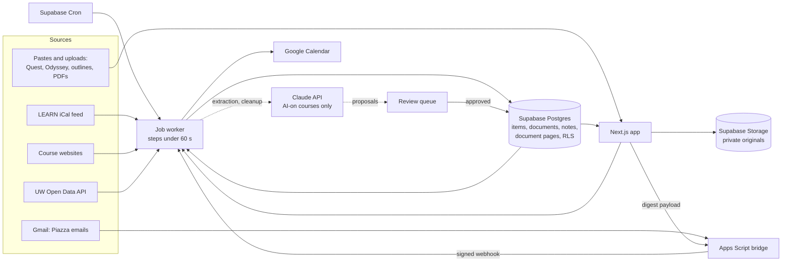

# Runway

A course tracker for one University of Waterloo student. It pulls every deadline, exam, and course document into one place, puts each dated item on Google Calendar with reminders and prep time, and makes all of it searchable in two taps.

## The problem

Waterloo scatters what a student needs across six systems:

- **LEARN** (the D2L Brightspace LMS) for some courses' deadlines and announcements
- **Course websites**, hand-written HTML that changes during the term
- **Piazza** for announcements in courses that skip LEARN
- **Quest** for class sections, times, and rooms
- **Odyssey** for exam rooms and seats, posted days before each exam
- **Course outlines** for weights, policies, and dates that appear nowhere else

Each has its own login, format, and update cadence. Missing one email can mean missing a quiz.

## What Runway does

- **One timeline.** Every source lands as items with a date, a kind, and a link back to where it came from, plus when that source last synced.
- **Nothing missed.** Items reach Google Calendar with reminders and prep blocks; a daily digest email lists what's coming.
- **Keep everything.** Raw inputs are stored verbatim. Pastes, emails, page snapshots, notes, and uploaded files are never overwritten.
- **Find anything.** A command palette and full-text search cover items, notes, documents, links, and every page of uploaded PDFs, with course aliases ("251 mt" finds the CS 251 midterm).
- **Documents.** Upload slides and textbooks; read them in an in-app PDF viewer with an outline sidebar and page-level search.
- **Notes.** Lecture notes are kept as written. For courses whose outlines allow AI, Claude adds a cleaned copy and answers questions with citations to the exact note.

## Architecture

Slow work (syncs, LLM calls, calendar writes, PDF indexing) goes through a `jobs` table. Each step finishes in under 60 seconds to fit Vercel's Hobby plan and re-queues itself until done. Every synced row carries `(source, source_ref)` and upserts on it, so running a sync twice changes nothing.

## Sources

| Source | How Runway reaches it | Why that way |
|---|---|---|
| LEARN | The student's private iCal feed URL, fetched hourly | Brightspace's REST API needs an admin-registered app; the calendar feed doesn't |
| Course websites | Fetched on a schedule with ETag and Last-Modified; dedicated parsers for structured pages, text diffs for the rest | Public pages, fetched politely with a named User-Agent and only from an allow-list |
| UW Open Data API | REST with an API key, daily | Official final exam schedule and important dates |
| Piazza | Real-time notification emails, read from Gmail every 15 minutes by a Google Apps Script bridge and posted to a signed webhook | Piazza's terms prohibit scraping, so no unofficial API clients |
| Quest | Paste of the class schedule, read by a rule-based parser | Behind WatIAM and Duo; Runway never automates those logins |
| Odyssey | Paste, or a userscript that posts the table while the student is signed in | Same login wall; seats appear only days before an exam |
| Course outlines | Read once per term into the term config; later versions by paste | outline.uwaterloo.ca disallows automated access in robots.txt |

Details, cadences, and quirks for each: [`docs/SOURCES.md`](docs/SOURCES.md).

## The review queue

Anything extracted from free text (an outline, a Piazza email, an Odyssey paste, a grade page) becomes a **proposal**, never an item. The student approves, edits, or dismisses it, and each item records which source last changed it. Structured sources like the LEARN feed and the course page parsers skip review, because their fields map one to one.

## The per-course AI switch

Three of the four Fall 2026 courses ban generative AI, and their outlines name running course materials through it as a Policy 71 (academic integrity) violation. So every course has an AI switch, off unless its outline allows AI:

- Every prompt builder calls `assertAiAllowed(courseId)` before anything leaves for Claude ([`src/lib/ai/switch.ts`](src/lib/ai/switch.ts)). Content with no course waits until one is picked.
- Notes, pastes, emails, page diffs, uploaded scans, and embeddings for AI-off courses never reach an AI service. Those courses still get everything else: syncs, calendar, search, the PDF viewer, and rule-based parsers.
- Tests spy on the Claude client and prove AI-off paths never call it and never write an `ai_calls` row (for example [`tests/lib/files/no-ai-path.test.ts`](tests/lib/files/no-ai-path.test.ts)).

## Documents

PDFs upload straight from the browser to a private storage bucket. Textbooks are indexed page by page in background steps ("Indexed 312 of 840 pages") using the PDF's own text layer, with no AI. The viewer (pdf.js) has page navigation, fit width and fit page, a selectable text layer, an outline built from the PDF's bookmarks or its numbered headings, and search inside the document, across a course's files, from the Library, and from the palette, each opening the matching page.

## Built overnight by an autopilot

Phases 1 to 8 were built unattended by Claude Code under the rules in [`docs/AUTOPILOT.md`](docs/AUTOPILOT.md), driven by [`scripts/autopilot/autopilot.mjs`](scripts/autopilot/autopilot.mjs): one phase per session, a commit per step, lint, typecheck, tests, and build before every push, and anything needing a human (a credential, a click) parked in [`docs/BLOCKED.md`](docs/BLOCKED.md) instead of waited on. The plan is [`docs/PHASES.md`](docs/PHASES.md); every judgment call is logged in [`docs/DECISIONS.md`](docs/DECISIONS.md).

## Stack

- Next.js 16 (App Router, TypeScript strict, Turbopack), React 19, Tailwind CSS 4, shadcn/ui
- Supabase: Postgres with row-level security on every table, Auth (Google), Storage, Cron, Vault
- Claude API (`@anthropic-ai/sdk`) with structured outputs and citations
- FullCalendar, react-pdf, unpdf, node-ical, cheerio, zod, date-fns-tz
- Google Calendar API, Google Apps Script
- Vitest and Playwright; deployed on Vercel

## Run it locally

1. `npm ci`
2. Create a Supabase project, then link it and apply the schema: `npx supabase link`, `npx supabase db push --linked`.
3. Copy `.env.example` to `.env.local` and fill it in ([`docs/SETUP.md`](docs/SETUP.md) walks through each account). Without the optional keys, the matching sources are skipped, not broken.
4. `npm run dev`, sign in, and press **Load Fall 2026 (example) setup** in Settings, Term. That loads the made-up term in [`src/config/term.example.ts`](src/config/term.example.ts).
5. For your own term: copy the example to `src/config/term.local.ts` (gitignored), fill it in following [`src/config/term.template.ts`](src/config/term.template.ts), and run `npm run term:upload`. Settings, Term then loads yours.

Checks: `npm run lint && npm run typecheck && npm run test && npm run build`.
